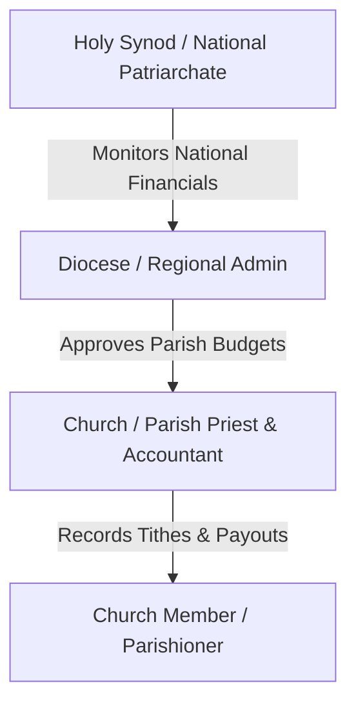

# 🎨 UI/UX Design & Architectural Documentation
## Tewahedo Connect - Ethiopian Orthodox Tewahedo Church ERP

---

### ✝️ Executive Summary
This document outlines the UI/UX design specification and Android XML layout implementation for **Tewahedo Connect**, a digital Enterprise Resource Planning (ERP) platform for the Ethiopian Orthodox Tewahedo Church (EOTC). 

The goal of this UI/UX design is to create an intuitive, respectful, and highly accessible user experience for church administrators, bishops, accountants, and parishioners.

---

### 👥 User Personas & Ecclesiastical Roles

1. **Holy Synod Admin (National)**
   * **Goal**: Monitor nationwide financial summaries, diocese audit logs, and sacred assets.
   * **UI Need**: High-level KPI summary cards, national map view, and global transaction feeds.

2. **Diocese Admin (Regional Bishop)**
   * **Goal**: Manage regional parish budgets, approve large expenses, and track clergy deployments.
   * **UI Need**: Regional analytics dashboards, multi-stage approval lists, and parish overview grids.

3. **Parish Accountant / Priest (Local)**
   * **Goal**: Quick & error-free recording of Tithes (10%), Sunday offerings, Chure aid payouts, and certificates.
   * **UI Need**: Form input views with clear labels, digital receipt generation, and offline sync indicators.

4. **Church Member (Parishioner)**
   * **Goal**: View contribution history, pay digital tithes, and manage Chure membership.
   * **UI Need**: Simple mobile card views, clear transaction status badges, and digital certificates.

---

### 🎨 Material Design 3 Color Palette

| Color Name | Hex Code | Purpose |
| :--- | :--- | :--- |
| **Ecclesiastical Navy** | `#1B2A4A` | Primary app bar, headers, and major buttons |
| **Orthodox Gold** | `#D4AF37` | Accent highlights, role badges, and primary icons |
| **Dark Navy** | `#0F182B` | Status bar, dark surfaces |
| **Success Green** | `#2E7D32` | Income totals, approved status, positive trends |
| **Error Red** | `#C62828` | Expense totals, rejected status, low fund warnings |
| **Surface Card** | `#FFFFFF` | Material 3 elevation cards |
| **Background** | `#F4F6F9` | Neutral background tint |

---

### 📐 Jetpack Compose to Android XML Component Mapping

| UI Feature | Modern Android XML Component | Layout File |
| :--- | :--- | :--- |
| **Splash Screen** | `ConstraintLayout`, `CircularProgressIndicator` | `activity_splash_modern.xml` |
| **Login Screen** | `MaterialCardView`, `TextInputLayout` | `activity_login_modern.xml` |
| **Role Dashboard** | `MaterialCardView`, `GridLayout`, `RecyclerView` | `fragment_dashboard_modern.xml` |
| **Income Entry** | `TextInputLayout`, `AutoCompleteTextView`, `MaterialButton` | `fragment_record_income_modern.xml` |

---

### 📂 Created XML Layout Artifacts

1. [`activity_splash_modern.xml`](file:///C:/Users/hp/AndroidStudioProjects/ORTHODOXAPP2/app/src/main/res/layout/activity_splash_modern.xml): Modern ecclesiastical splash screen.
2. [`activity_login_modern.xml`](file:///C:/Users/hp/AndroidStudioProjects/ORTHODOXAPP2/app/src/main/res/layout/activity_login_modern.xml): Elevated card-based login interface with input validation and quick demo account helper.
3. [`fragment_dashboard_modern.xml`](file:///C:/Users/hp/AndroidStudioProjects/ORTHODOXAPP2/app/src/main/res/layout/fragment_dashboard_modern.xml): Role-based main dashboard with summary KPI cards, 2x3 service grid, and transaction feeds.
4. [`fragment_record_income_modern.xml`](file:///C:/Users/hp/AndroidStudioProjects/ORTHODOXAPP2/app/src/main/res/layout/fragment_record_income_modern.xml): Clean financial form layout for entering tithes, offerings, and generating digital receipts.

---
© 2026 Tewahedo Connect UI/UX Team. Designed on branch `UI/UX`.
